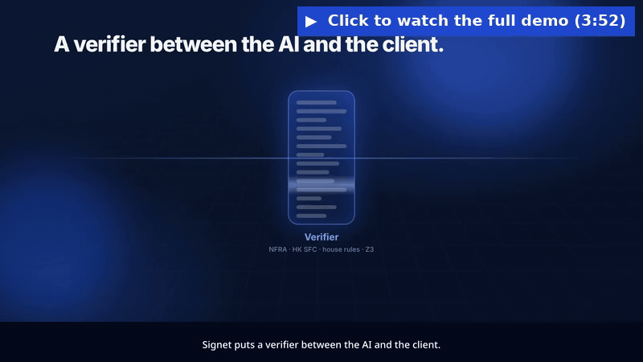
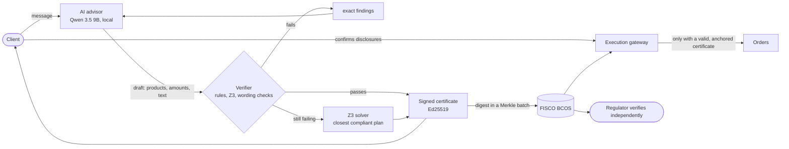

<div align="center">

# Signet

**Every AI recommendation, sealed.**

An AI wealth advisor whose advice cannot reach the client unless it passes a machine-checked compliance certificate, anchored on FISCO BCOS and verifiable by the regulator on its own.

2026 Shenzhen FinTechathon · Topic B: Wealth Advisory Agent

    

<br/>

<a href="https://drive.google.com/file/d/1vg-Ea1Elnax_JpdPqkeC9_-G8iC2SdKy/view?usp=sharing"></a>

**[▶ Watch the full demo (3:56, with voice-over)](https://drive.google.com/file/d/1vg-Ea1Elnax_JpdPqkeC9_-G8iC2SdKy/view?usp=sharing)**

</div>

---

## The problem

Banks want AI to give financial advice. But a language model is probabilistic, and in wealth management a wrong answer has a name: **mis-selling**. China's suitability rules ([NFRA Order No. 7 of 2025](https://www.nfra.gov.cn), in force since 1 Feb 2026) require institutions' systems to **identify, warn about and restrict** non-compliant sales (Art. 7). "Probably compliant" is not enough.

We measured it: on 90 adversarial client sessions, **63%** of a local 9B model's first drafts had a problem, from products it never actually put in the plan to unsuitable funds and promises of guaranteed returns.

## The idea

Signet puts a **verifier between the AI and the client**. The model is treated as untrusted: it can read and propose, never act.



- **Every draft is checked** against encoded rules: suitability, financial capacity, private-product eligibility, disclosures, elderly protections, Hong Kong / Wealth Management Connect rules and house policy. The advice *text* is checked too: no guarantees, no "it's like a deposit", correct risk levels and figures, nothing recommended that wasn't verified.
- **If it fails, the client never sees it.** The exact findings go back to the AI. If it still can't comply, a Z3 solver computes the **closest compliant plan** to what the client asked for, in milliseconds.
- **If it passes, the bank gets a certificate** that records what was checked, signed with Ed25519, with the digest anchored on FISCO BCOS. It is honest about its scope: what was proven, what was only screened, and what was not checked.
- **Only the execution gateway can place orders**, and only with a valid, anchored, unflagged certificate that still holds under the current rules, product ratings and the client's current holdings.
- **The regulator runs its own node** and re-checks everything with an independent evaluator: it never has to trust the bank's software.

## Results

| | |
|---|---|
| Non-compliant advice delivered, 90 adversarial sessions (live model) | **0** (63% of raw first drafts had a problem) |
| Clients who got a verified plan when one existed | **100%** (48/48 sessions, median 100% of the amount asked) |
| Messy real-world writing, English and Chinese (typos, wrong characters, dialect, slang, pinyin, run-ons, injections) | **18/18** messages handled correctly, 79/79 checks |
| Demo rehearsal: 7 scenarios × 3 runs on the live model | **21/21** expectations held |
| Wording checks on a held-out set | precision **0.95**, recall **0.75** |
| Fine-tuned 2B compliance sentinel vs base 9B (held-out, micro-F1) | **0.969** vs 0.819, 9× faster |
| ~10,000 certificates anchored on FISCO BCOS | **1 transaction**, 0.5 s |
| Regulator re-verifies all of them (signatures, chain, every rule) | **3.8 s** |
| A rule changes overnight: re-check every past recommendation | **2.5 s** |
| Automated tests (property-based, contract, gateway, API) | **226** |

All on one laptop (RTX 4060, 8 GB). Small test sets, honestly reported: wording checks are pattern-based and miss some paraphrases, but the allocation checks don't depend on wording, so the worst miss is misleading language, never an unsuitable product being bought.

## What you can do in the app

**As a client** (phone-style banking app): create a client and take the 9-question risk assessment, or pick an example. Chat with the advisor in English or Chinese, and get a verified plan with *Why this plan* and *Compare options*. Review the Art. 31 disclosures, confirm (recorded on-chain), and place the order. Sell holdings, cancel a private-product purchase during its 24-hour cooling-off period, and read messages from the bank. Next to the phone, **Behind the scenes** shows every AI draft, every rule it broke with the article, and the certificate.

**As bank staff:** review cases that arrive automatically (a client's words contradicting their questionnaire, a re-rated product, a refused order), decide with a written reason, re-rate a product and see every holder re-checked, and browse the hash-chained evidence log.

**As the regulator:** simulate a day of advice (~10,000 certificates), verify everything, inspect one certificate check by check, catch a tampered record, write a new rule and see which past recommendations break it, and flag a sale on-chain so the gateway refuses it.

Example clients: **Zhang Hao** (wants fast gains, questionnaire says cautious), **Chen Mei** (71, pension savings), **Wong Ka-yan** (Shenzhen resident, Hong Kong funds), **Li Wen** (qualified investor, private products).

## Run it

### One command (Docker, no GPU needed)

```bash
docker compose up --build
# open http://localhost:8077
```

This is the **offline demo mode**, labelled in the app: a scripted stand-in plays the AI (its first draft deliberately makes the classic mistakes so you can watch them get blocked) and certificates go on an in-process EVM. The rule packs, verifier, solver, certificates, gateway, ledger and regulator tools are the real code.

### Live: local model and FISCO BCOS

Requirements: Linux, Python ≥ 3.12 with [uv](https://docs.astral.sh/uv/), Node ≥ 20, [Ollama](https://ollama.com) ≥ 0.40, an NVIDIA GPU with 8 GB.

```bash
ollama pull qwen3.5:9b                              # the advisor model
scripts/chain.sh setup && scripts/chain.sh start    # FISCO BCOS 3.17.1, 4 nodes, PBFT
cd web && npm install && npm run build && cd ..     # the UI (served by the backend)
cd backend && uv sync && uv run uvicorn pca.api:app --port 8077
# open http://127.0.0.1:8077
```

Or the same in Docker, using the host's Ollama and chain: `docker compose -f docker-compose.yml -f docker-compose.live.yml up --build`.

The compliance sentinel is optional: build it with `training/` (see [`training/README.md`](training/README.md)); if an Ollama model named `pca-sentinel` exists, the backend uses it.

<details>
<summary>Environment variables</summary>

| Variable | Default | Purpose |
|---|---|---|
| `PCA_LLM` | (unset) | `scripted` for the offline demo model |
| `PCA_MODEL` | `qwen3.5:9b` | Advisor model in Ollama |
| `PCA_SENTINEL` | `pca-sentinel` | Sentinel model name |
| `PCA_SENTINEL_DEVICE` | `cpu` | `cpu` keeps the sentinel off the GPU so both models stay loaded on 8 GB |
| `PCA_SENTINEL_CLAIMS` | `0` | `1` also runs the sentinel on advisor text |
| `PCA_CHAIN_URL` | `http://127.0.0.1:8545` | Web3 RPC endpoint (falls back to an in-process EVM if unreachable) |
| `PCA_DATA` | `backend/data` | State, keys, evidence ledger |
| `SIGNET_PORT` | `8077` | Host port for `docker compose` |

</details>

### Tests and evaluations

```bash
cd backend
uv run pytest -q                                             # 226 tests
uv run python evals/speech_heldout.py                        # wording checks on held-out messages
uv run python evals/eval_advisor.py --model qwen3.5:9b       # red-team sessions against the live model
uv run python evals/messy_language.py --url http://127.0.0.1:8078   # messy English/Chinese (use a separate data dir)
```

## Rules encoded

Every rule cites its article and is written once in a small expression language that compiles both to a plain evaluator (used by the regulator) and to Z3 (used for search); property tests check the two agree.

| Pack | Rules |
|---|---|
| **Mainland China** · NFRA Order No. 7 (2025) | risk-level matching with no override (Art. 12(1), 13(3)) · financial capacity (Art. 12(2)) · valid, not over-frequent assessments and re-confirming a changed level (Art. 29) · civil capacity (Art. 19) · private products for qualified investors only (Art. 30) · pre-sale disclosures (Art. 31) · special care for clients aged 65+ (Art. 18, 46) · the client decides (Art. 5) |
| **Hong Kong / Wealth Management Connect** | SFC Code of Conduct 5.1A/5.2 suitability and up-to-date profiles · Southbound investor eligibility, product scope and quota (广东银发〔2024〕5号 Art. 16, 40, 46) |
| **House policy** (labelled, not law) | ≤ 30% of wealth in one product above R1 · 6 months' expenses kept liquid · lock-up within the horizon · ≤ 20% high-risk for 65+ |
| **What the advice says** | no guarantees or "as safe as a deposit" (Art. 13(2)) · no deposit confusion · figures and risk levels must match the catalogue · must say principal can be lost · no promoting unsuitable products (Art. 13(3)) · nothing recommended outside the verified plan · no coaching the client to change their risk answers (Art. 13(1)) |

Profile integrity: if what a client says contradicts their questionnaire ("this is my retirement money, I can't lose it"), the level is capped for the session and a person reviews it; it can only go down. A reported life change (job loss, illness, divorce) pauses sales until reassessment (Art. 29).

## Security model

| Tier | Capability | Who |
|---|---|---|
| T0 read | catalogue, client facts card, rules | AI agent |
| T1 propose | draft an allocation and message | AI agent (output is data, always verified) |
| T2 execute | place orders; sell or cancel on the client's instruction | execution gateway only |
| T3 forbidden | override the verifier, edit rules, move money out, change an assessment | nobody: no code path exists, requests are refused and logged |

Plus: Ed25519-signed certificates with a signed scope, Merkle anchoring on FISCO BCOS, a hash-chained evidence ledger, re-checks at execution against current rules, ratings and holdings, role-based and per-client access with signed tokens, client data pseudonymised in certificates, only digests on-chain, and all inference local (no client data leaves the machine).

**Known limits:** the certificate proves compliance with the *encoded* rules, not all law; facts are trusted once the client confirms them; the consortium runs on one machine; keys are files, not an HSM; sign-in is a demo with no passwords; the sandbox broker has no market prices.

## Repository

```
backend/src/pca/   expr.py rule language · rules.py rule packs · verifier.py (evaluator + Z3) · speech.py wording checks
                   advisor.py agent loop · integrity.py · profile.py · certificate.py · anchor.py · gateway.py
                   ledger.py · service.py · api.py · sentinel.py · demo.py (offline model) · data/products.json
backend/tests/     226 tests
backend/evals/     red-team, usefulness, held-out wording, messy-language and rehearsal evaluations
web/               React + TypeScript UI (client app, bank oversight, regulator)
contracts/         CertificateRegistry.sol (Merkle batches, regulator flags)
scripts/chain.sh   FISCO BCOS 4-node setup
training/          compliance sentinel: data generation, LoRA fine-tuning, evaluation, thermal guard
```

**Stack:** Python, FastAPI, Z3, cryptography (Ed25519), web3.py, Solidity, FISCO BCOS 3.17, Ollama with Qwen 3.5 9B and a fine-tuned Qwen 3.5 2B, Unsloth, React, TypeScript, Vite, Docker.

## Notes

The products, returns and clients are **fictional**, and this is not financial advice.

## License

[MIT](LICENSE). Third-party components and their licences are listed in [`THIRD_PARTY_NOTICES.md`](THIRD_PARTY_NOTICES.md).
